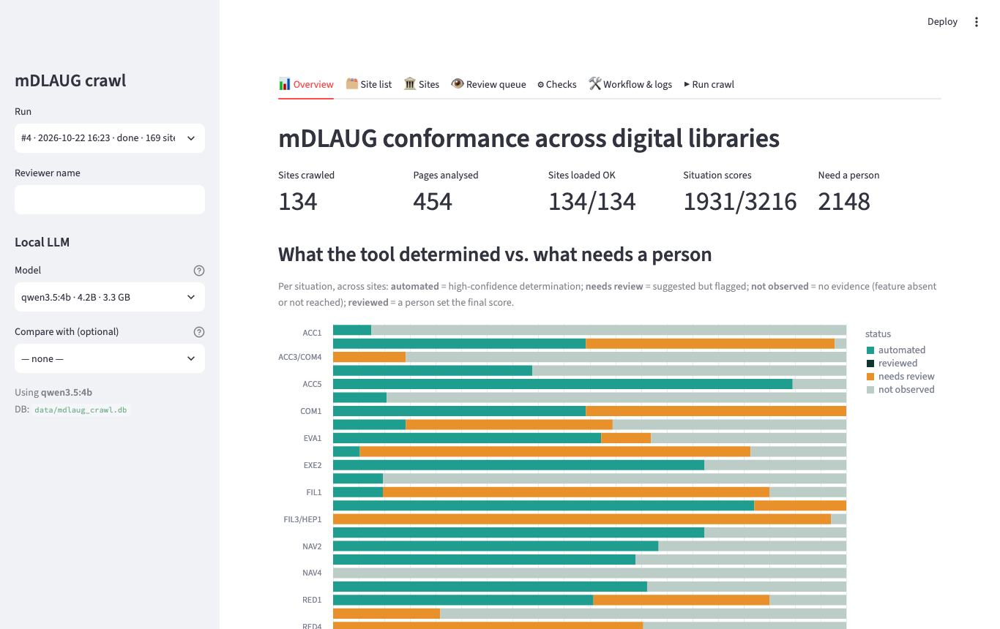
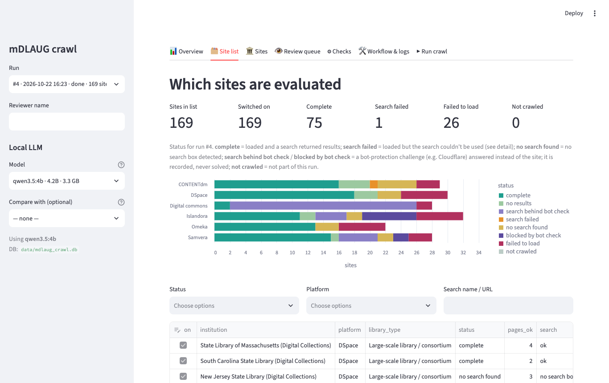
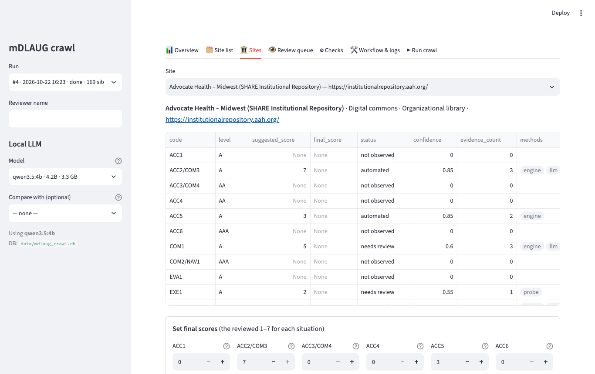
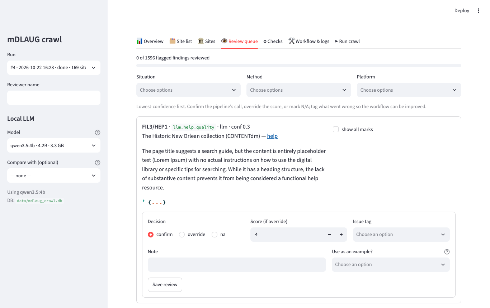
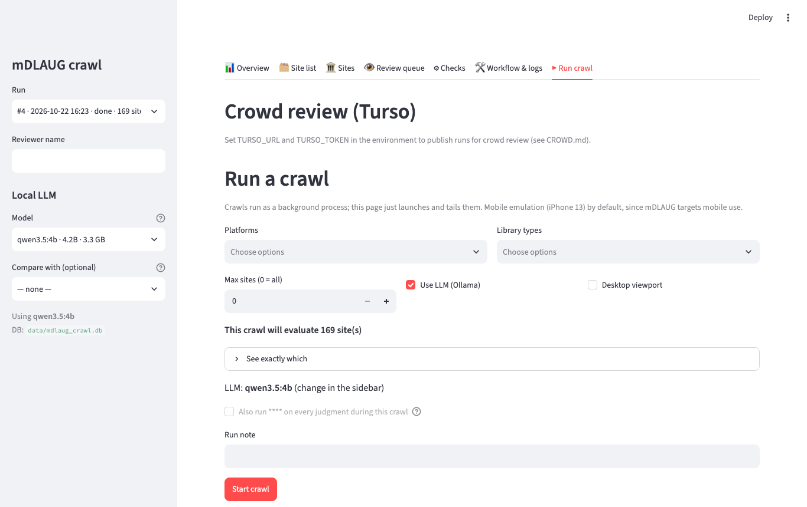

# mDLAUG crawler: training

This guide gets you from nothing to exploring real results in about 20 minutes. You don't need
to know how to program. You'll copy a few short commands into a **terminal** (a window where
you type commands), and everything else happens in your web browser.

**What you'll be able to do by the end**

- Open the crawler's app and look through the October 2026 results for 132 digital libraries
- Run a small test crawl of your own
- Review the crawler's findings (the part that needs a person)
- Make the Vendor Accessibility Signals report

**Just want to read the results?** You don't need to install anything:
[open the report](https://alibama.github.io/mdlaug/signals/).

**You need:** a Windows 10/11 PC or a Mac, an internet connection, about 2 GB of free disk
space, and permission to install programs in your own user account (no administrator
password is needed).

---

## Step 1. Download the project

1. Download this file: **[mdlaug-main.zip](https://github.com/alibama/mdlaug/archive/refs/heads/main.zip)**
2. Unzip it.
   - **Mac:** double-click the downloaded file.
   - **Windows:** right-click the downloaded file → **Extract All…** → **Extract**.
3. Move the unzipped `mdlaug-main` folder somewhere easy to find, such as your **Documents** folder.

Inside it, the folder you'll work in is **`mdlaug-crawler`**.

## Step 2. Open a terminal in the `mdlaug-crawler` folder

**Mac**

1. Press <kbd>Cmd</kbd> + <kbd>Space</kbd>, type **Terminal**, and press <kbd>Return</kbd>.
2. Type `cd` followed by a space. Don't press Return yet.
3. Drag the **`mdlaug-crawler`** folder from Finder into the Terminal window. Its location appears after `cd `.
4. Press <kbd>Return</kbd>.

**Windows**

1. Open the `mdlaug-main` folder in File Explorer, then open **`mdlaug-crawler`**.
2. Right-click an empty part of the folder window and choose **Open in Terminal**.
   (On Windows 10, click the address bar at the top instead, type `powershell`, and press <kbd>Enter</kbd>.)

You're in the right place if typing the next command doesn't say "not found".

## Step 3. Install everything (once)

Copy the command for your computer, paste it into the terminal, and press <kbd>Enter</kbd>/<kbd>Return</kbd>.

**Mac**
```bash
bash mdlaug.sh setup
```

**Windows**
```
.\mdlaug setup
```

This installs everything the crawler needs into the `mdlaug-crawler` folder: its own copy of Python, the
libraries, and the Chromium browser it drives. Nothing else on your computer changes. It takes
5–10 minutes the first time. Lines starting with `==` tell you what it's doing. It finishes with
**Setup finished**.

If it stops with an error, look at [Troubleshooting](#troubleshooting). It's always safe to run
setup again.

## Step 4. Load the October 2026 results

**Mac**
```bash
bash mdlaug.sh get-data
```

**Windows**
```
.\mdlaug get-data
```

This downloads the database from the October crawl (about 9 MB). If you'd also like the home-page
screenshots, which let the app show what each site looked like, add `--screenshots` to the end
(`bash mdlaug.sh get-data --screenshots` / `.\mdlaug get-data --screenshots`). That's a 336 MB download.

## Step 5. Open the app

**Mac**
```bash
bash mdlaug.sh app
```

**Windows**
```
.\mdlaug app
```

Your browser opens the app at **http://localhost:8501** after a few seconds. (If it doesn't, open
that address yourself.) The app runs on your own computer; nothing is sent anywhere.

**Keep the terminal window open while you use the app.** To stop the app, click the terminal and
press <kbd>Ctrl</kbd> + <kbd>C</kbd>.

## Step 6. Find your way around the app

The tabs along the top are the parts of the work. The menu on the left chooses which **run** (one
crawl of the site list) you're looking at. It opens on the October crawl, run 4.

**Overview**: how much the crawler could decide on its own for each mDLAUG situation (green),
and how much needs a person (orange).



**Site list**: every site, whether this run reached it, and what happened to its search. You can
switch sites on or off and add new ones here.



**Sites**: one site at a time, with a score for each of the 24 mDLAUG situations, the evidence
behind it, and (if you downloaded the screenshots) the page with each finding marked.



**Review queue**: findings the crawler wasn't sure about, least confident first. This is where
people make the biggest difference (see Step 8).



**Run crawl**: start a crawl from the app instead of the terminal.



The **Checks** tab explains each mDLAUG situation and how it's judged. **Workflow & logs** is
for troubleshooting the crawler itself.

## Step 7. Run a small test crawl

Open a **second** terminal in the `mdlaug-crawler` folder (repeat Step 2) so the app can keep
running, then:

**Mac**
```bash
bash mdlaug.sh trial
```

**Windows**
```
.\mdlaug trial
```

This crawls 3 sites, one each on CONTENTdm, DSpace and Omeka, in about 5 minutes. You'll see a line
for each finished site. When it says **run … complete**, refresh the app and pick the new run from
the **Run** menu on the left.

A crawl visits each site the way a phone would. It:

1. handles any cookie banner or pop-up, after recording how accessible it is;
2. tries the search box with the keyboard, as a screen-reader user would;
3. opens a result, the help page and a browse page;
4. records every check it can make, and how sure it is of each.

## Step 8. Review findings

The crawler is honest about what it can't decide: alt-text quality, whether a help page actually
helps, how something sounds in a screen reader. Those go to the **Review queue**, and the statistics
can't use them until people have checked a sample.

1. Type your name in **Reviewer name** on the left.
2. Open **Review queue**. Each card shows the finding, the crawler's reasoning and the marked-up page.
3. Under **Decision**, choose **confirm** if the crawler got it right, **override** if it didn't (then
   set your own **Score**, 1–7), or **na** if the check doesn't apply to this page.
4. If the crawler got something wrong, pick what went wrong under **Issue tag**.
5. For a really clear case, set **Use as an example?** to **good** or **bad**. Examples teach the
   crawler's AI judgments what to look for.
6. Press **Save review**.

About 30 reviews per check, from two people, tells us whether that check can be trusted. Each review
takes a minute or two.

## Step 9. Make the Vendor Signals report

**Mac**
```bash
bash mdlaug.sh report
```

**Windows**
```
.\mdlaug report
```

This runs the statistics (a few minutes) and opens the report in your browser. It uses the largest
crawl in your database. The published October version is at
**https://alibama.github.io/mdlaug/signals/**.

How to read it:

- Each card is one measure, compared across platforms. A dark bar marked **DIFFERS** is a platform
  that stands apart from the others.
- **Assert now** means the difference passed every check: it's significant after allowing for running
  many tests, it holds within each type of institution, it doesn't depend on Digital Commons alone,
  and it shows up again in a second crawl. These are safe to tell a vendor.
- **Supporting** means it's significant but failed one of those checks; the card says which.
- **Vendor ask** is the concrete fix to request.

## Optional: local AI models

The crawler can use free AI models that run on your own computer to judge things rules can't
(is this alt text meaningful? does this help page explain anything?). Without them everything still
works; those judgments just go to the review queue.

1. Install **Ollama** from [ollama.com](https://ollama.com) and open it.
2. In a terminal, run these two commands (each downloads about 3 GB):
   ```
   ollama pull qwen3.5:4b
   ```
   ```
   ollama pull gemma3:4b
   ```
3. Run `bash mdlaug.sh doctor` (Mac) or `.\mdlaug doctor` (Windows). It should say Ollama is running.

## Optional: crawl every site

**Mac**
```bash
bash mdlaug.sh crawl
```

**Windows**
```
.\mdlaug crawl
```

This crawls every site in your site list (169 once you've run `get-data`) and takes several hours. Keep the computer plugged in, awake and with the lid
open; a sleeping computer pauses the crawl. You can stop it with <kbd>Ctrl</kbd> + <kbd>C</kbd>; the
sites it finished are kept.

---

## Cheat sheet

| What | Mac | Windows |
|---|---|---|
| Install everything (once) | `bash mdlaug.sh setup` | `.\mdlaug setup` |
| Download the October results | `bash mdlaug.sh get-data` | `.\mdlaug get-data` |
| Open the app | `bash mdlaug.sh app` | `.\mdlaug app` |
| Test crawl of 3 sites | `bash mdlaug.sh trial` | `.\mdlaug trial` |
| Crawl every site | `bash mdlaug.sh crawl` | `.\mdlaug crawl` |
| Make the report | `bash mdlaug.sh report` | `.\mdlaug report` |
| Check that everything works | `bash mdlaug.sh doctor` | `.\mdlaug doctor` |
| List the commands | `bash mdlaug.sh help` | `.\mdlaug help` |
| Stop the app or a crawl | <kbd>Ctrl</kbd> + <kbd>C</kbd> | <kbd>Ctrl</kbd> + <kbd>C</kbd> |

## Troubleshooting

Start with **doctor**. It checks each part and tells you the fix:
`bash mdlaug.sh doctor` (Mac) or `.\mdlaug doctor` (Windows).

| You see | What to do |
|---|---|
| `No such file or directory` (Mac) or `is not recognized` (Windows) | The terminal isn't in the `mdlaug-crawler` folder. Repeat Step 2. |
| `Not set up yet` | Run setup (Step 3). |
| Setup stops while downloading | Check your internet connection and run setup again. It picks up where it left off. |
| Windows says **running scripts is disabled** | Make sure you typed `.\mdlaug`, not `.\scripts\windows.ps1`. |
| `curl: command not found` (Linux) | Install curl with your package manager, then run setup again. |
| The browser doesn't open with the app | Open **http://localhost:8501** yourself. |
| `Port 8501 is already in use` | The app is already running in another terminal. Use that one, or stop it with <kbd>Ctrl</kbd> + <kbd>C</kbd>. |
| The app shows no results | Run `get-data` (Step 4) or a `trial` (Step 7), then refresh the page. |
| Pictures missing in Sites / Review queue | Run `get-data --screenshots`, or look at a run you crawled yourself. |
| A crawl says `bot-protection challenge` | That site checks for automated visitors. The crawler records it and moves on, by design. |
| Sidebar says Ollama isn't reachable | That's fine if you skipped local AI. Otherwise open the Ollama app. |

Still stuck? Copy the last 20 lines from the terminal into a message to the project team.

## Words you'll see

- **Run**: one crawl of the site list. Each run is kept, so results can be compared over time.
- **Site**: one digital-library collection (its address is in the Site list).
- **Platform** or **vendor**: the software a site runs on, such as CONTENTdm, DSpace, Digital
  Commons, Islandora, Omeka or Samvera.
- **Vendor-verified**: the site's own pages confirm which platform it runs.
- **mDLAUG situation**: one of 24 problems blind and visually impaired users meet in digital
  libraries, each with a code like `FIL1` (finding the search) or `INT1` (pop-up layers).
- **Finding**: one thing the crawler checked on one page, with a score from 1 (bad) to 7 (good) and
  how sure it is.
- **Overlay**: anything that covers the page when it opens, such as a cookie banner or pop-up.
- **Bot check**: a "verify you are human" page some sites show automated visitors. The crawler never
  tries to get past one.

## Getting updates

Download the ZIP again (Step 1) and unzip it. To keep your own results, copy the **`data`** folder
from your old `mdlaug-crawler` folder into the new one, then run setup once.

Comfortable with git? `git clone https://github.com/alibama/mdlaug.git` and `git pull` work too.
